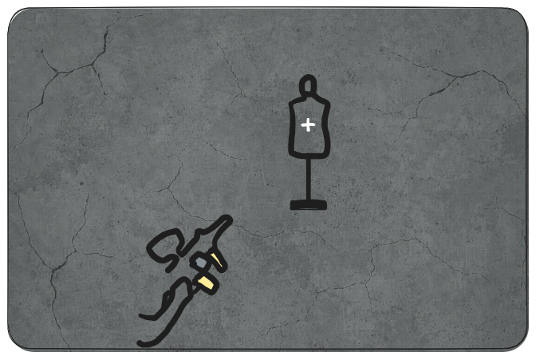
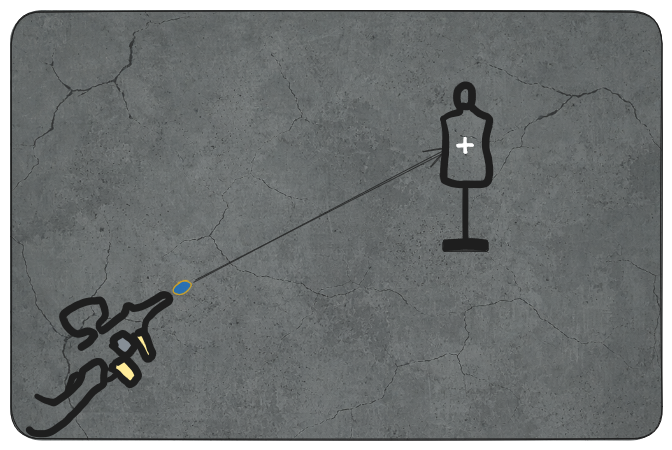
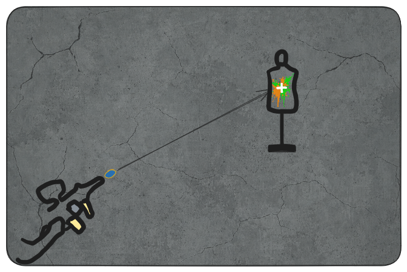
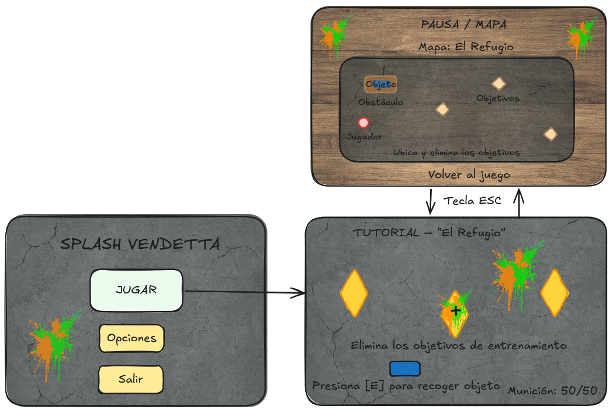

# Splash Vendetta — Documento de Diseño de Juego (GDD)

**Biblia del Juego · Versión 1.1 · 1 de noviembre de 2026**

| Campo | Detalle |
|---|---|
| Autor | Junior Esteban Benavides Arias — Diseñador de juego principal |
| Programa | Desarrollo de Videojuegos y Entornos Interactivos · Ficha 3336515 · SENA |
| Estado del documento | Vigente. Incluye lo validado en la segunda iteración del prototipo (Build V1.1 y ajustes posteriores) |
| Alcance | Solo diseño. Las decisiones técnicas de implementación se documentan aparte (diagramas UML, pseudocódigo y código del repositorio) |

---

## 1. Visión general

| Elemento | Definición |
|---|---|
| Título | Splash Vendetta |
| Género | Shooter táctico en primera persona (FPS) con elementos de sigilo |
| Plataforma | PC (Windows) |
| Perspectiva | Primera persona |
| Estilo visual | 3D estilizado (semirrealista), atmósferas oscuras y fuertes contrastes de colores neón (pintura) |
| Modelo de negocio | Premium (pago único) con tienda cosmética opcional |

**Frase gancho.** En Splash Vendetta asumes el papel de Skoll en un intenso shooter táctico 3D. Armado con marcadoras de pintura, te infiltras en el bajo mundo clandestino para cazar, marcar y eliminar a la facción responsable de arrebatarle todo.

### 1.1 Sinopsis y objetivos

- **Objetivo principal:** progresar por escenarios cerrados completando las misiones asignadas, sin ser detectado cuando sea posible.
- **Objetivo táctico:** identificar, marcar con pintura neón y eliminar objetivos con sigilo y precisión.
- **Experiencia buscada:** la tensión de la infiltración combinada con una propuesta visual estilizada, donde cada impacto de pintura deja huella en el escenario.

### 1.2 Público objetivo

- **Perfil:** jugadores midcore y hardcore con experiencia en juegos de acción y disparos en primera persona.
- **Edad:** 16 años en adelante.
- **Plataforma:** usuarios de PC con dominio de teclado y ratón.
- **Intereses:** precisión, sigilo y decisiones tácticas (como en Counter-Strike o Rainbow Six Siege), atraídos además por el uso de pintura y colores neón visto en Splatoon.
- **Motivaciones:** superar desafíos con habilidad, precisión y planificación; disfrutar la infiltración; vivir una jugabilidad distinta dentro del género.

---

## 2. Alcance del prototipo vertical (v1.1)

El prototipo valida la mecánica nuclear y su integración con un primer combate. Se compone de dos escenas jugables conectadas por una puerta.

**Incluye:**

- **“El Refugio” (tutorial):** sótano clandestino donde el jugador se mueve, recoge su marcadora de una mesa y practica tiro contra tres maniquíes (algunos con movimiento).
- **“Nivel 01” (primer combate):** zona con obstáculos que sirven de cobertura y un único enemigo que persigue y dispara al jugador.
- Sistema de vida, derrota y reinicio.
- Interfaz de juego mínima (mira, contador de objetivos, barra de vida, mensajes de interacción y pantalla de derrota) y controles para teclado y ratón.
- Efectos visuales y sonoros base (mancha de pintura al impactar, sonido de disparo y de impacto, ambiente del sótano).

**Fuera del alcance de esta versión:**

- Comportamiento avanzado de enemigos (patrullas, varios enemigos coordinados, detección por sigilo).
- Sistema de progresión y economía.
- Niveles adicionales.
- Arte y audio definitivos, música dinámica.
- Menú principal y pausa con mapa (diseñados en el wireframe, aún sin implementar).

---

## 3. Bucle de juego

1. **Preparación:** el jugador explora y recoge su equipo.
2. **Apuntado:** coloca la mira sobre el objetivo; apuntar con precisión reduce la velocidad de movimiento.
3. **Disparo:** lanza una bola de pintura que viaja con una ligera caída.
4. **Impacto:** la pintura deja una mancha neón y el objetivo reacciona.
5. **Avance:** al cumplir el objetivo del escenario, el jugador pasa al siguiente.

---

## 4. Mecánicas

| # | Mecánica | Qué hace el jugador | Estado |
|---|---|---|---|
| M1 | Movimiento táctico | Se desplaza en primera persona; puede caminar, correr y agacharse para reducir su visibilidad y ruido | Implementada |
| M2 | Interacción y recogida | Se acerca a un elemento y pulsa el botón de acción para recoger equipo o usar una puerta | Implementada |
| M3 | Apuntar con acercamiento | Mantiene el botón de apuntar: la vista se acerca y el movimiento se vuelve más lento | Implementada |
| M4 | Disparo de pintura (mecánica nuclear) | Dispara bolas de pintura que dejan manchas neón al impactar | Implementada |
| M5 | Eliminación de objetivos de entrenamiento | Elimina tres maniquíes; un contador muestra el progreso (0/3 a 3/3) | Implementada |
| M6 | Enemigo con persecución y disparo | Se enfrenta a un único enemigo que lo detecta, lo persigue, dispara, se cubre y recarga | Implementada (versión básica) |
| M7 | Vida, daño y derrota | Pierde vida al recibir disparos; al llegar a cero ve “HAS SIDO ELIMINADO” y puede reintentar | Implementada |
| M8 | Puertas y cambio de escena | Pulsa el botón de interacción frente a la puerta para pasar del tutorial al primer nivel | Implementada (animación de apertura pendiente) |
| M9 | Sigilo | Reduce su visibilidad y el ruido para evitar ser detectado | Planeada |
| M10 | Menú principal, pausa y mapa | Inicia la partida desde un menú y abre el mapa del escenario con la tecla ESC | Planeada (diseñada en el wireframe) |

### 4.1 Reglas de diseño por mecánica

**M1 · Movimiento táctico.** Caminar es la velocidad base. Correr permite desplazarse más rápido y, en versiones futuras, generará más ruido. Agacharse es más lento, pero reduce visibilidad y ruido. Cada postura debe sentirse distinta y tener una razón táctica.

**M2 · Interacción y recogida.** Cuando el jugador está al alcance de algo con lo que puede interactuar, aparece un mensaje en pantalla con la tecla a pulsar (por ejemplo, “[E] Recoger” o “[F] Entrar”). El mensaje debe aparecer siempre que se cumpla la condición, sin importar cuántas veces haya recorrido el jugador las escenas. El equipo que ya se recogió no vuelve a aparecer en su lugar original al cambiar de escena.

**M3 · Apuntar con acercamiento.** Al apuntar, la vista se acerca para ayudar a acertar objetivos lejanos y el personaje se mueve más despacio. Es una decisión táctica: más precisión a cambio de movilidad.

**M4 · Disparo de pintura (mecánica nuclear).**

- **Propósito:** es la acción principal del juego. Sirve para marcar superficies, completar los objetivos de entrenamiento y dañar al enemigo.
- **Acción:** el clic izquierdo dispara una bola de pintura hacia el punto que señala la mira central.
- **Condición:** el jugador solo puede disparar después de recoger la marcadora (M2).
- **Precisión:** apuntar con acercamiento (M3) hace el disparo más preciso, a cambio de moverse más despacio.
- **Ritmo de disparo:** pausado y deliberado, para premiar la puntería sobre la ráfaga. Valor por calibrar en pruebas.
- **Munición:** limitada, con indicador en pantalla (por implementar).
- **Retroalimentación inmediata:** al disparar se oye el aire comprimido de la marcadora; al impactar aparece la mancha neón con su sonido húmedo (ver sección 5).
- **Criterios de aceptación de diseño:**
  1. Cada pulsación produce un solo disparo, sin retraso perceptible.
  2. El proyectil sale hacia donde apunta la mira.
  3. Cada disparo se acompaña de su sonido.
  4. El comportamiento del proyectil en vuelo y al impactar se rige por la ficha de la sección 5.

**M5 · Objetivos de entrenamiento.**

- Hay tres maniquíes con el logo de la facción enemiga en el pecho.
- Algunos maniquíes se mueven para exigir mayor precisión.
- Cada maniquí cuenta una sola vez, sin importar cuántos impactos reciba.
- Hasta eliminar los tres, el jugador no puede completar el tutorial.

**M6 · Enemigo.**

- Detecta al jugador cuando entra en su rango de detección y lo persigue de forma continua mientras permanezca en él.
- Apunta y dispara proyectiles que dañan al jugador, con pausas para recargar.
- Usa los obstáculos como cobertura y responde de forma defensiva cuando es atacado.
- Puede ser eliminado al agotar su vida.
- No debe atravesar paredes ni objetos, ni detenerse sin motivo.

**M7 · Vida, daño y derrota.**

- Tanto el jugador como el enemigo tienen vida y pueden recibir daño.
- La barra de vida del jugador se ubica en un borde de la pantalla para no estorbar la zona central.
- Al recibir daño, los bordes de la pantalla se tiñen de rojo para que el jugador entienda de inmediato que está siendo atacado.
- Al perder toda la vida aparece el mensaje de derrota con la opción de reintentar.

**M8 · Puertas.** La puerta conecta el tutorial con el primer nivel. El cambio de escena debe funcionar de forma idéntica en recorridos repetidos.

**M9 · Sigilo (planeada).** Agacharse reduce el ruido y la visibilidad del jugador. En versiones futuras, los enemigos reaccionarán a ambos factores. Esta mecánica aún no forma parte del prototipo.

---

## 5. Objeto dinámico: el proyectil de pintura

### 5.1 Ficha

| Campo | Descripción |
|---|---|
| Nombre | Proyectil de pintura (bola de pintura de la marcadora BT TM-15) |
| Rol | Es el elemento central del juego: sirve para marcar, dañar y eliminar, y deja la huella visual característica |
| Comportamiento | Dinámico: se crea al disparar, viaja por el escenario y reacciona al chocar |
| Quién lo usa | El jugador y, con su propio arma, el enemigo |

### 5.2 Comportamiento en tres fases

**Fase 1 · Preparación y apuntado.** El jugador mueve la mira con el ratón. Al mantener el botón derecho apunta: la vista se acerca y el movimiento se vuelve más lento para priorizar la precisión.

**Fase 2 · Disparo y vuelo.** Al pulsar el botón izquierdo, la marcadora lanza el proyectil hacia donde apunta la mira, acompañado del sonido de aire comprimido. Mientras vuela, cae ligeramente por su peso, como una bola de pintura real.

**Fase 3 · Impacto y reacción.** Al chocar con una superficie, el proyectil desaparece y deja una mancha de pintura neón pegada a la superficie, con un sonido húmedo (“splat”) que se oye desde el punto del impacto y un breve resplandor neón sobre la mancha.

### 5.3 Parámetros de diseño

| Parámetro | Intención de diseño | Valor |
|---|---|---|
| Velocidad de salida | Rápida: el disparo debe sentirse inmediato y preciso a corta distancia | Por calibrar en pruebas |
| Caída por peso | Ligera: casi imperceptible de cerca y apreciable a larga distancia, para premiar la lectura de distancia | Por calibrar en pruebas |
| Alcance práctico | Pensado para salas y pasillos cerrados | Por calibrar en pruebas |
| Duración de la mancha | Temporal: se desvanece a los pocos segundos para no saturar el escenario | Aproximadamente 2 s en el prototipo actual |
| Color principal | Verde neón (#08E000); naranja (#FF8800) como color alterno | Definido |
| Munición | Limitada, con indicador en pantalla | Referencia del wireframe: 50 / 50 (por implementar) |

### 5.4 Qué ocurre según lo que golpea

| Si el proyectil golpea… | Resultado |
|---|---|
| Muro, piso o techo | Mancha neón plana, completa y nítida desde cualquier ángulo, con sonido de impacto |
| Maniquí | Mancha sobre el cuerpo; el maniquí cuenta como eliminado una sola vez y el contador avanza |
| Enemigo | Reduce su vida; si llega a cero, queda eliminado |
| Obstáculo de cobertura | Lo bloquea: el proyectil no lo atraviesa |
| Al propio jugador o a su arma | Nunca los golpea |

### 5.5 Reglas generales

- Cada proyectil produce un único impacto.
- Los disparos en ráfaga no deben afectar la fluidez del juego: las manchas antiguas desaparecen.
- El disparo siempre va acompañado de su sonido, y el impacto, de su mancha y su sonido.

### 5.6 Criterios de aceptación de diseño

1. A larga distancia, el jugador percibe una trayectoria ligeramente curva.
2. No hay retraso perceptible entre el impacto, la mancha y el sonido.
3. La mancha se ve completa en cualquier superficie y desde cualquier ángulo, sin cortes ni parpadeos.
4. Disparar varias veces seguidas no reduce la fluidez.
5. Un mismo proyectil nunca cuenta dos veces.

### 5.7 Bocetos

Los bocetos siguen las tres fases del comportamiento.

---

## 6. Interfaz y controles

### 6.1 Controles (teclado y ratón)

| Acción | Control |
|---|---|
| Desplazarse | W A S D |
| Mirar | Ratón |
| Disparar | Clic izquierdo |
| Apuntar con acercamiento | Clic derecho |
| Agacharse | C |
| Recoger equipo | E |
| Interactuar (puertas) | F |
| Pausa / mapa (planeado) | ESC |
| Continuar tras el mensaje del tutorial | ENTER |

### 6.2 Elementos de pantalla

- **Mira central:** una cruz pequeña y limpia.
- **Contador de objetivos:** “BLANCOS ELIMINADOS: X / 3”.
- **Barra de vida del jugador:** en un borde de la pantalla.
- **Munición** (diseñada en el wireframe; por implementar).
- **Mensajes de interacción:** “[E] Recoger objeto”, “[F] Entrar”.
- **Indicador de daño:** bordes rojos al recibir un ataque.
- **Pantalla de derrota:** “HAS SIDO ELIMINADO” con botón “REINTENTAR”.

### 6.3 Mapa de navegabilidad

El flujo parte del menú principal (Jugar, Opciones y Salir), pasa al tutorial “El Refugio” y de ahí al “Nivel 01” por la puerta. Desde el juego, ESC abre la pausa con el mapa del escenario, donde se ve al jugador, los objetivos y los obstáculos. Si el jugador pierde, puede reintentar.

**Estado:** el menú principal y la pausa con mapa están diseñados en el wireframe, pero aún no están implementados en el prototipo.

---

## 7. Dirección de arte, ambientación y audio

### 7.1 Estilo y paleta

- **Estilo:** 3D estilizado (semirrealista). El entorno sucio e industrial contrasta con el brillo caricaturesco de la pintura.
- **Skoll:** pelaje gris medio (#A7A7A7), ojos verdes (#5AC476), camiseta blanca (#EFEFEF) y pantalón azul (#4570A4).
- **Armamento y equipo:** negros, marrón terroso y verde oliva, de aspecto sobrio y militar.
- **Entorno:** grises oscuros (#373B3B) y tonos asfalto (#555A59), con manchas de pintura neón (naranja #FF8800, verde #08E000) que rompen la oscuridad.

### 7.2 Atmósfera e iluminación

- Sótano clandestino, oscuro y lúgubre, con concreto agrietado.
- No hay luz solar: el escenario se baña en penumbra para generar encierro y tensión.
- Un foco de techo ilumina la mesa con el arma; una luz sutil sobre la marcadora guía al jugador a recogerla y desaparece al hacerlo.
- Una luz neón verde detrás de los maniquíes indica dónde están los objetivos.

### 7.3 Efectos ambientales

Polvo flotando lentamente, goteo ocasional desde el techo y salpicadura de pintura al impactar.

### 7.4 Audio

| Sonido | Descripción |
|---|---|
| Ambiente del sótano | Bucle continuo y bajo: eco sutil, goteo y lluvia lejana |
| Disparo de la marcadora | Sonido corto y rápido de aire comprimido |
| Impacto de pintura | Sonido húmedo y viscoso, algo grave y denso |
| Respiración de Skoll | Respiración pesada y agitada que refuerza la tensión |

Los sonidos de disparo e impacto se perciben en el espacio: el jugador distingue desde dónde llegan.

---

## 8. Economía del juego (versión completa)

Este sistema no forma parte del prototipo; se implementará en futuras expansiones.

**Moneda:** Créditos Clandestinos.

**Fuentes de ingreso:**

- Finalización de misión (recompensa base).
- Bonificación por precisión (eliminaciones limpias y aciertos en zonas críticas).
- Bonificación por eficiencia y tiempo.
- Multiplicador por infiltración sin activar alarmas.

**Gastos (tienda del refugio):**

- Mejoras de la marcadora: mayor capacidad de pintura y mayor presión (más velocidad y menos caída del proyectil).
- Equipamiento táctico: chalecos con más espacio y trajes de camuflaje que atenúan el ruido.

---

## 9. Modelo de monetización

- **Premium (pago único):** el juego completo se adquiere con un solo pago. Todas las mecánicas y modos están disponibles sin compras adicionales.
- **Tienda cosmética opcional:** aspectos para las marcadoras, variantes de pintura fluorescente y atuendos alternativos para Skoll.
- **Principio:** ninguna compra da ventaja competitiva (0 % pay-to-win).

---

## 10. Benchmarking de mercado

| Criterio | Rainbow Six Siege | CS:GO / CS2 | Valorant | Splatoon | Hitman | **Splash Vendetta** |
|---|---|---|---|---|---|---|
| Jugabilidad | Infiltración táctica y asedio en espacios cerrados | Shooter táctico por rondas con objetivos | Shooter táctico con habilidades especiales | Shooter de arena rápido, basado en control de área | Infiltración, sigilo y asesinatos planeados | Infiltración táctica, sigilo y precisión en espacios cerrados |
| Estilo de arte | Realista / militar | Realista / militar | Estilizado (cel shading) / neón | Estilizado (cartoon) / neón vibrante | Realista / sobrio | Estilizado semirrealista con contrastes neón |
| Mecánica nuclear | Destrucción del entorno y disparo táctico | Disparo con patrones de retroceso | Disparo táctico con poderes | Disparar pintura para cubrir el mapa | Ocultamiento y uso de objetos clave | Disparo de pintura con caída que altera el entorno y el combate |
| Perspectiva | Primera persona | Primera persona | Primera persona | Tercera persona | Tercera persona | Primera persona |
| Monetización | Premium + pases y cosméticos | Gratuito + mercado de aspectos | Gratuito + cosméticos premium | Premium + DLC | Premium + contenido adicional | Premium + tienda cosmética |
| Plataforma | PC y consolas | PC | PC y consolas | Nintendo Switch | PC y consolas | PC (Windows) |

**Qué aporta cada referente:** Rainbow Six Siege, la tensión del combate en espacios cerrados; CS, la puntería precisa; Valorant, el ritmo competitivo y la creatividad táctica; Splatoon, la influencia visual y mecánica de la pintura; Hitman, la planificación y el sigilo.

---

## 11. Hoja de ruta

| Fase | Contenido | Estado |
|---|---|---|
| 1 · Conceptualización | Documento de alto concepto, GDD, benchmarking | Entregada |
| 2 · Prototipo vertical | “El Refugio”: mecánica nuclear, efectos, sonido y corrección de fallos | Entregada |
| 2.1 · Validación | Enemigo básico, eliminación de objetivos, combate, pruebas con 5 jugadores y ajustes (Build V1.1) | Entregada |
| 3 · Producción | Comportamiento avanzado de enemigos, más niveles, progresión | Por entregar |
| 4 · Arte y audio finales | Modelos de alta resolución, música dinámica | Por entregar |
| 5 · Alfa / Beta y pruebas | Pruebas ampliadas | Por entregar |
| 6 · Lanzamiento | Versión comercial y tienda cosmética | Por entregar |

---

## 12. Mejoras y pendientes de diseño

- Animación de apertura de la puerta (propuesta de un jugador en las pruebas).
- Sigilo completo: reacción de los enemigos al ruido y la visibilidad.
- Más enemigos y comportamientos defensivos más variados.
- Implementar el menú principal y la pausa con mapa, ya diseñados en el wireframe.
- Implementar el indicador de munición.

---

## 13. Historial de versiones

| Versión | Fecha | Cambios |
|---|---|---|
| 1.0 | 2026 | Primera versión (Tarea Integradora 4): mecánica nuclear, economía, monetización, benchmarking y wireframes |
| 1.1 | 1 nov 2026 | Se separa de los documentos de entrega y se aloja en el repositorio. Se elimina el lenguaje técnico y se actualiza el alcance con lo validado en la iteración 2: enemigo, combate, vida, objetivos móviles, acercamiento al apuntar y cambio de escena. Se agrega la ficha del proyectil de pintura |

---

## 14. Referencias

- Nintendo. (2015). *Splatoon*. https://www.nintendo.com/en-gb/Games/Wii-Ugames/Splatoon-892510.html
- Riot Games. (2026). *VALORANT: un juego de disparos táctico 5v5 con agentes que poseen habilidades únicas*. https://playvalorant.com/es-mx/
- Sony Interactive Entertainment. (2026). *HITMAN World of Assassination*. PlayStation. https://www.playstation.com/es-co/games/hitman-3/
- Ubisoft. (2020). *Tom Clancy’s Rainbow Six Siege*. https://www.ubisoft.com/es-mx/game/rainbow-six/siege/game-info/discover
- UDIT. (2026). *El manifiesto del Game Designer: por qué tu juego necesita un Game Design Document (GDD) y cómo crearlo como los profesionales*. Universidad de Diseño, Innovación y Tecnología. https://www.udit.es/el-manifiesto-del-game-designer-por-que-tu-juego-necesita-un-game-design-document-gdd-y-como-crearlo-como-los-profesionales/
- Valve. (2026). *Counter-Strike: Global Offensive*. https://blog.counterstrike.net/es/acerca-de/
